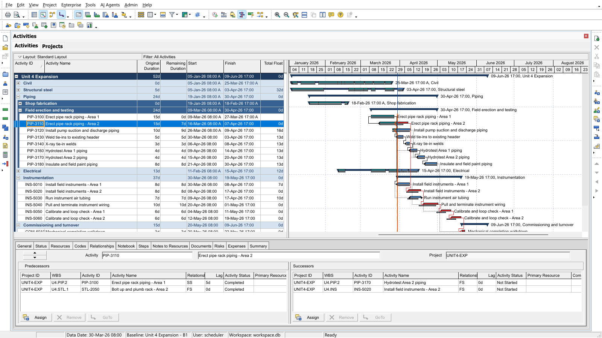
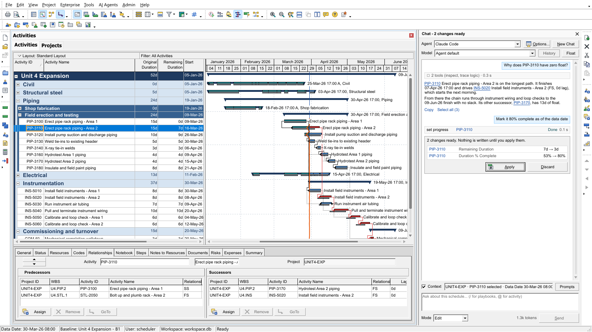
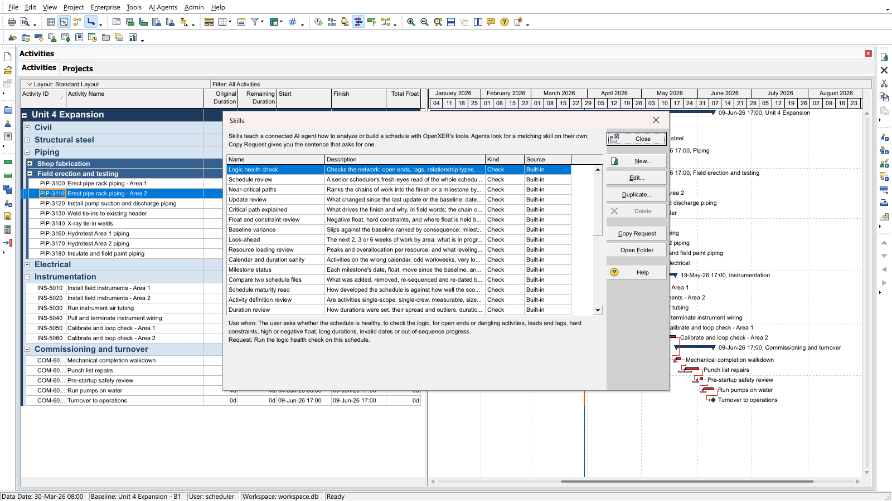
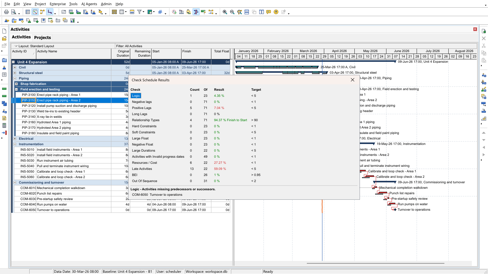
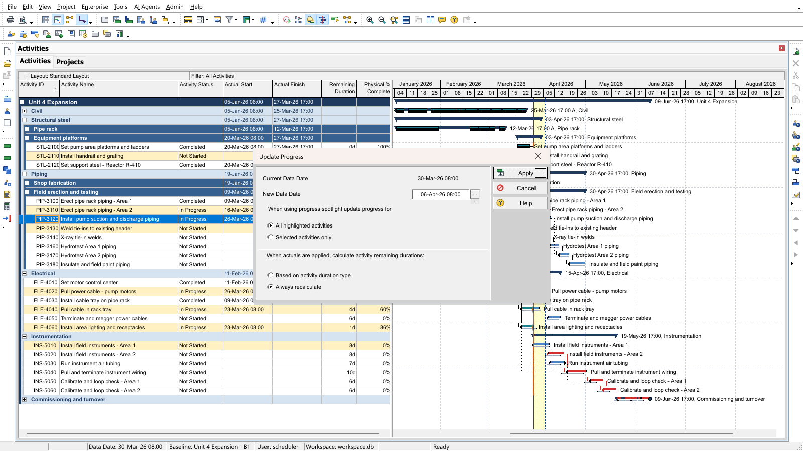
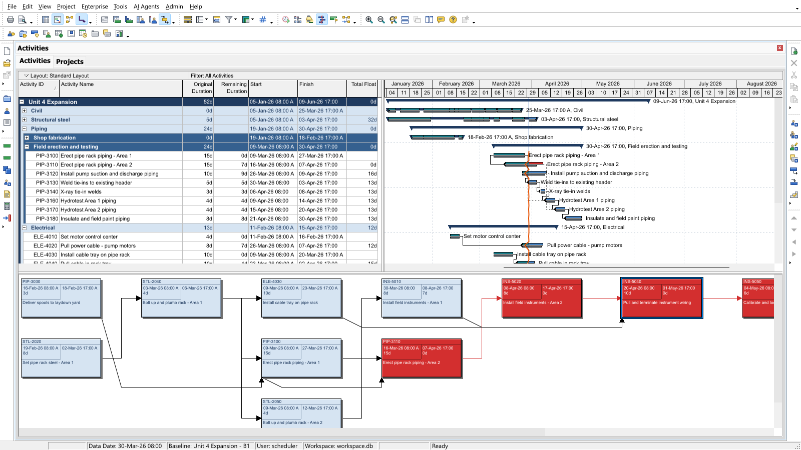
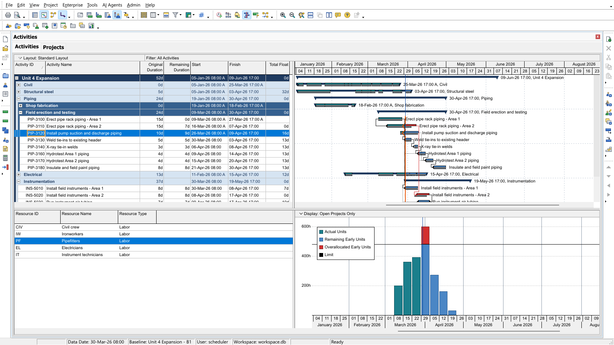
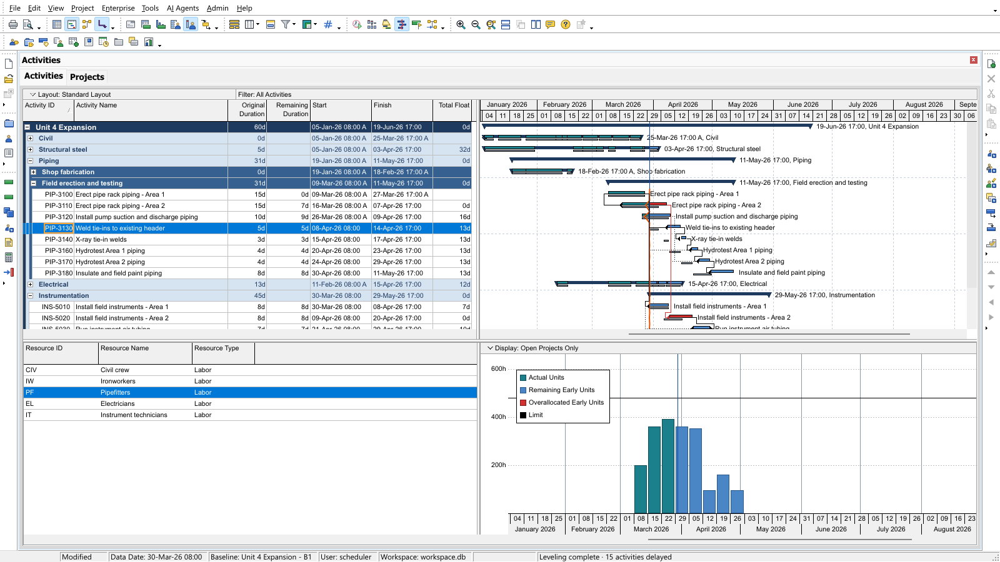
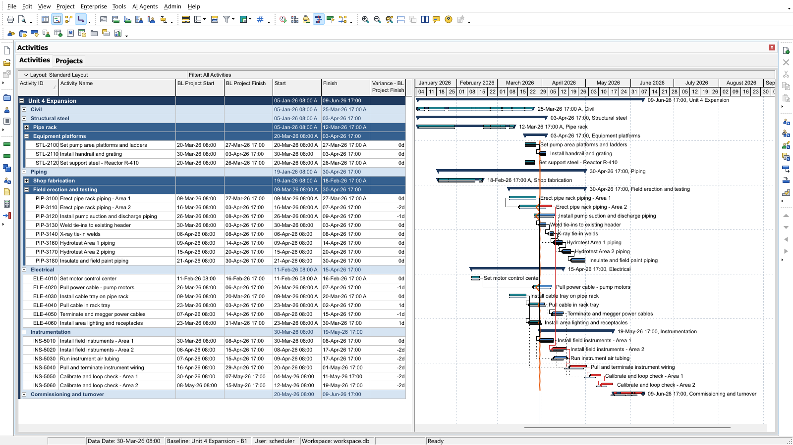
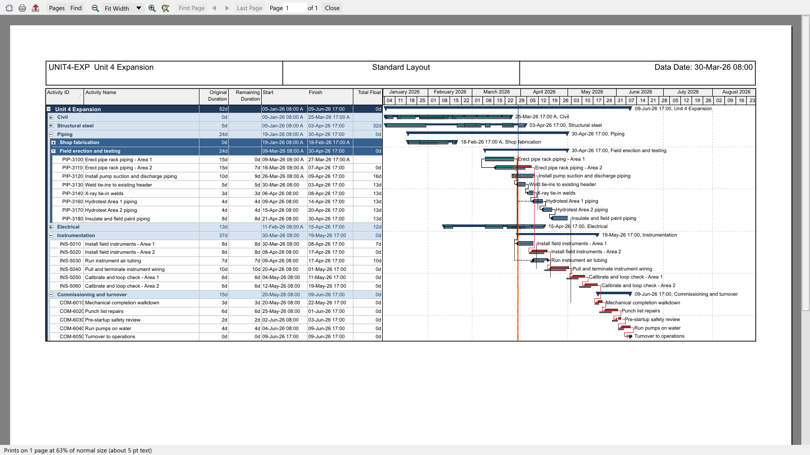

<h1 align="center">OpenXER</h1>

<p align="center">
  <b>A fast, native desktop scheduler for XER files, built to be driven by AI agents. Free, open source and local.</b><br>
  Open a schedule, run it, level it, update it, check it, report it and save it back out as XER.<br>
  Every edit you can make in the app, an agent can make through <code>openxer-cli</code> and MCP, under the same rules.
</p>

<p align="center">
  
  
  
  
  
  
</p>

<p align="center">
  <a href="https://github.com/OpenXER/openxer/releases/latest/download/OpenXER-0.1.1-setup.exe">
    
  </a>
  &nbsp;
  <a href="https://github.com/OpenXER/openxer/releases/latest/download/OpenXER-0.1.1-x86_64.AppImage">
    
  </a>
</p>

<p align="center">
  <sub>
    Windows 10/11 (64-bit) &middot; Linux x86_64 (AppImage: <code>chmod +x</code> and run) &middot;
    <a href="https://github.com/OpenXER/openxer/releases/latest">All downloads (portable ZIP, Linux tarball, SHA256)</a>
  </sub>
</p>

<p align="center">
  <a href="#why-openxer">Why</a> ·
  <a href="#built-for-ai-agents">AI Chat &amp; Skills</a> ·
  <a href="#open-and-save-xer">XER</a> ·
  <a href="#plan-and-schedule">Schedule</a> ·
  <a href="#update-progress">Progress</a> ·
  <a href="#the-activity-table-and-gantt-chart">Table and Gantt</a> ·
  <a href="#check-the-logic">Logic</a> ·
  <a href="#resources-and-leveling">Resources</a> ·
  <a href="#baselines">Baselines</a> ·
  <a href="#print-and-report">Print</a> ·
  <a href="#install">Install</a> ·
  <a href="#build-from-source">Build</a>
</p>

<p align="center"><br><sub>The Activities view on a sample construction schedule: table, Gantt chart and Activity Details.</sub></p>

---

## Why OpenXER

Construction runs on legacy scheduling software: expensive licenses, heavy installs, databases and servers to look after, slow screens and workflows that have not changed in decades.

OpenXER keeps what schedulers already know. The activity table sits beside the Gantt chart with the details pane underneath. Layouts, filters, grouping, the dialogs and the terms are the ones you use every day, and XER goes in and comes out. There is nothing to relearn.

It adds what the legacy tools lack:

- **Built for AI agents.** Open the built-in **AI Chat (`F8`)** docked right beside the Gantt chart, choose from **30 prebuilt scheduling skills**, or connect external agents through `openxer-cli` and the built-in MCP server. Every edit runs through the exact same scheduling rules as the app.
- **Instant.** A single native program. It starts in a moment and stays responsive on large schedules.
- **Local.** Runs offline on one machine. No server, no database to install, no account, no telemetry. Your schedules stay in a workspace file on your disk, and the XER files you open are never modified.
- **Accurate.** A full critical path engine with calendars, constraints, lags, relationship types, Level of Effort activities, progress and resource leveling. Schedules calculate to the dates, float and leveled dates stored in the XER files it reads, verified against the update histories of real construction projects.
- **Free and open.** Open source under MIT or Apache-2.0. No license keys, no seat counts.
- **Modern.** A clean interface in its own colors, with the familiar layout intact.

## Built for AI agents

Legacy scheduling software was built for one person clicking through dialogs. OpenXER is built for that person **and** for the AI agent working beside them. The built-in Chat window, the 30 prebuilt scheduling skills, the command line and the MCP server all share the same edit layer as the app, so every answer comes from real schedule calculations and every approved edit lands exactly as if you had typed it.

### Built-in AI Chat (`F8`)

Press <kbd>F8</kbd> (or **AI Agents > Chat**) to open AI Chat docked beside your activity table and Gantt chart. The assistant inspects the open project directly through OpenXER's native tools, links every Activity ID it mentions so clicking it jumps straight to that row, and previews edits as a field-by-field proposal you approve or reject in one click.

<p align="center"><br><sub>Built-in AI Chat docked beside the schedule: tool calls, clickable Activity IDs and a reviewable edit proposal before anything changes.</sub></p>

**Bring your own AI**

- **Sign in with ChatGPT:** use your own ChatGPT plan directly from the app.
- **Claude Code or Codex:** run through your existing local CLI agent with zero extra API keys.
- **OpenAI-compatible API:** point at any compatible endpoint with your own API key.
- **Local model on your PC:** point at Ollama, LM Studio or another local server so nothing leaves your machine.

### 30 prebuilt scheduling skills

OpenXER ships with **30 built-in scheduling skills** (`assets/skills/`) covering real project controls workflows, plus interactive playbooks in Chat. Connected agents discover and load the matching skill automatically, or you can open **AI Agents > Skills** to browse, edit, copy a ready-to-paste prompt, or author your own firm's standards in plain Markdown.

<p align="center"> Skills dialog listing OpenXER's 30 built-in scheduling skills with the Logic Health Check skill selected" width="100%"><br><sub>AI Agents &gt; Skills: browse, customize or add Markdown scheduling skills shared across the app, CLI and MCP server.</sub></p>

| Workflow | Prebuilt skills included |
|---|---|
| **Build & Scope** | `build-schedule`, `add-scope`, `resource-load`, `change-interview`, `schedule-basis` |
| **Weekly Updates** | `progress-update`, `update-review`, `look-ahead`, `milestone-status`, `compare-files` |
| **Audits & Health** | `logic-health-check`, `schedule-review`, `baseline-review`, `baseline-variance`, `float-constraint-review`, `calendar-duration-check`, `duration-review`, `activity-definition-review`, `sequence-review`, `resource-loading-review`, `schedule-maturity`, `levels-of-detail` |
| **Delay, Risk & Recovery** | `critical-path-explained`, `near-critical-paths`, `recovery-schedule`, `time-impact`, `contingency-float`, `risk-read` |
| **Executive Outputs** | `one-page-schedule`, `export-pack` |

Skills are plain Markdown files under [assets/skills/](assets/skills/): you do not need to write Rust to contribute. Fork the repo and open a pull request to improve a skill or share a new one with other schedulers.

**What you can hand to an agent**

- "Here is this morning's field report. Enter the progress, reschedule, and tell me what moved on the critical path."
- "Add the tie-in work from this RFI: four activities after the pipe rack, welded connections need an X-ray step."
- "The crew limit for pipefitters drops to 10 next week. Level the schedule and list every activity that slips more than two days."
- "Run a logic health check: open ends, lags over 5 days, constraints, out-of-sequence progress. Fix what is safe and list the rest."
- "Compare this update with last week's and write the change summary for the client."

**Connect external AI clients (MCP)**

In the app, open **AI Agents > Connect AI Agents...** and click **Connect** next to Claude Desktop, ChatGPT desktop and Codex (one setting serves both), or Claude Code. OpenXER writes the entry with the right path, backs the app's settings file up first, tests the connection and tells you what to do next: quit Claude Desktop from its tray icon and open it again, or restart ChatGPT desktop or Codex (in ChatGPT desktop use Work or Codex mode). Then ask: "Use OpenXER to inspect my schedule." The agent finds your workspace and its projects by itself. From a terminal, `openxer-cli connect all` does the same.

`openxer-cli mcp` runs a local MCP server over stdio. Any other MCP client can point at it:

```json
{
  "mcpServers": {
    "openxer": {
      "command": "C:\\Users\\you\\OpenXER\\openxer-cli.exe",
      "args": ["mcp"]
    }
  }
}
```

For Claude Code: `claude mcp add --scope user openxer -- "C:\Users\you\OpenXER\openxer-cli.exe" mcp`. The release ships this block as `openxer.mcp.json`; replace its `<full path to openxer-cli.exe>` with the path where you put the file.

**Or script it**

```text
openxer-cli inspect  --input week-14.xer
openxer-cli set-activity --input week-14.xer --activity PIP-3120 --field remaining_duration --value 16 --output week-14-updated.xer
openxer-cli schedule --input week-14-updated.xer --data-date "2026-04-06 08:00" --level true --output week-15.xer
openxer-cli apply    --input week-14.xer --changes field-report.json --dry-run
```

A whole update is one changes file, applied in order and all or nothing:

```json
{
  "format": "openxer-changes/1",
  "operations": [
    {"op": "set_project",  "field": "data_date", "value": "2026-04-06 08:00"},
    {"op": "set_activity", "activity": "PIP-3110", "field": "actual_finish", "value": "2026-04-03 15:00",
     "meta": {"source": "field report, April 3"}},
    {"op": "set_activity", "activity": "PIP-3120", "field": "remaining_duration", "value": 16},
    {"op": "relationship", "action": "add", "predecessor": "PIP-3130", "successor": "PIP-3140", "kind": "FS", "lag_hours": 0},
    {"op": "schedule", "level_resources": true}
  ]
}
```

**What you can count on**

- **The same rules as the app.** Statuses, durations, units and assignments follow exactly as they would if you typed the edit. Things are named the way you see them: Activity ID, resource short name, calendar name, WBS path.
- **Safe by design.** The input file is never modified; every change writes a new output. A batch that fails anywhere writes nothing, and `--dry-run` shows every field that would change.
- **Traceable.** Each edit can carry a `meta` note, such as the report or email it came from.
- **Proven on real projects.** The edit commands were verified by replaying the full update history of real construction projects through the CLI, week after week, and matching the scheduler's own stored results field for field, including on resource-leveled schedules.
- **Local.** The server runs on your machine and sees only the files you point it at. OpenXER itself sends nothing anywhere, except Chat when you use it with ChatGPT or with an API key: then your questions and the schedule data its tools read go to that service. With Claude Code, Codex or a model on your own PC, Chat itself sends nothing off it.

Tools: `openxer_inspect`, `openxer_load`, `openxer_schedule`, `openxer_apply`, `openxer_check_schedule`, `openxer_paths`, `openxer_compare`, `openxer_lookahead`, `openxer_milestones`, `openxer_schedule_stats`, `openxer_resource_loading`, `openxer_wbs_summary`, `openxer_skills`, `openxer_skill`, `openxer_set_activity`, `openxer_add_activity`, `openxer_delete_activity`, `openxer_assign`, `openxer_unassign`, `openxer_set_assignment`, `openxer_relationship`, `openxer_calendar_day`, `openxer_calendar_weekday`, `openxer_set_project`, `openxer_add_wbs`, `openxer_import`, `openxer_export` and `openxer_export_pdf`, among others. The full CLI, JSON, skills and MCP reference is in [automation/README.md](automation/README.md).

## Open and save XER

- Open any XER file and pick the projects you want when it holds several. Open several projects at once and see them side by side.
- Save to the local workspace, then export a clean XER whenever you need to send it on. Tables and fields OpenXER does not use are carried through untouched, so nothing in your file quietly disappears.
- Import into a new project, replace an existing one, or add activities into a project you already have. Undo Last Import takes it back.

## Plan and schedule

- Press <kbd>F9</kbd> to schedule. Schedule Options cover the data date, retained logic, progress override and actual dates, out-of-sequence progress, longest path, float paths, open ends and more. Each run writes a schedule log.
- Calendars with work weeks, shifts and holidays, a Must Finish By date and every constraint type.
- Turn on automatic scheduling and the dates follow every edit as you type.
- Check Schedule scores the schedule against common health targets: open ends, lags, relationship types, constraints, large and negative float, long durations, invalid progress dates, late activities, out-of-sequence progress and more. Each check can filter the table to the activities it finds.

<p align="center"><br><sub>Check Schedule results on the sample schedule.</sub></p>

## Update progress

- Edit status, actual start and finish, remaining duration and percent complete right in the table or in the Status tab of the details pane. Both follow the same rules.
- Update Progress and Apply Actuals move a whole period at once, and Progress Spotlight highlights what should have moved since the last update.
- Steps, expected finish, suspend and resume, and resource actuals on each assignment.
- Save Period Actuals (store period performance) against financial periods.

<p align="center"><br><sub>Update Progress with Progress Spotlight on the week after the data date.</sub></p>

## The activity table and Gantt chart

- Columns for every schedule, resource, cost, earned value, code and user-defined field, with your own widths and titles.
- Group by WBS, activity codes or any field, with band totals, intervals by week or month and page breaks.
- Filters with nested All/Any conditions and dates relative to the data date, so a three-week lookahead is one filter that moves with every update.
- Drag bars to change dates, drag between bars to link them, click a relationship line to edit it. Curtains, text attachments, sight lines, a progress line and baseline bars.
- A timescale that zooms from hours to years, scroll bars on both sides and optional line numbers.
- Show Trace Logic, Activity Network, usage profiles and spreadsheets, or a second table and Gantt in the bottom pane. Split the window into tab groups and open a second Activities view with its own layout.
- Save it all as named layouts, and export or import layouts to share them.

## Check the logic

- Trace Logic draws the predecessors and successors of the selected activity as a network, critical path in red.
- Activity Critical Path shows the backward and forward driving paths through any activity.
- Driving relationships, free and total float, float paths and the longest path in the table.
- Schedule Comparison lists added, deleted and changed activities, relationships and fields between two projects, or between a project and its baseline.

<p align="center"><br><sub>Trace Logic for the instrument wiring activity.</sub></p>

## Resources and leveling

- Resources, roles, rates, shifts, curves and calendars, all editable.
- Assign resources and roles, set units, lag and overtime, and record actuals by assignment.
- Expenses, cost accounts, funding sources and currencies.
- Resource usage profiles and spreadsheets by day, week or month, in units or costs, with cumulative curves, against each resource's limit.
- Level Resources with priorities, limits and calendars, and a leveling log of what moved.

<table>
<tr>
<td width="50%" valign="top"><br><sub>Before: the pipefitters are overloaded the week of the data date.</sub></td>
<td width="50%" valign="top"><br><sub>After Level Resources: the work fits under the crew limit.</sub></td>
</tr>
</table>

## Baselines

- Keep any number of baselines, assign a project baseline and up to three user baselines, and update them by the Update Baseline options (what to add, delete and carry for activities, assignments and the project), with a preview of every change first.
- Baseline bars on the Gantt chart, baseline dates and variance columns in the table, and earned value against the baseline you choose.

<p align="center"><br><sub>Current dates against the project baseline, with finish variance.</sub></p>

## Print and report

- Print and Print Preview from the layout on screen, with page setup for paper, margins, headers, footers and legends. Publish straight to PDF.
- A Reports window with a starter set of scheduling reports: lookaheads by WBS, critical activities, open ends and logic gaps, progress this period, predecessors and successors, milestones, baseline variance and resource usage by week. Run them to PDF, HTML, text or print preview.
- Build your own reports, organize them in groups and run a batch in one go. Report definitions from other scheduling tools can be imported.

<p align="center"><br><sub>Print Preview of the layout on screen.</sub></p>

## Install

Download directly from the **[Latest Release](https://github.com/OpenXER/openxer/releases/latest)**:

| Platform | Recommended download | Portable download |
|---|---|---|
| **Windows 10/11 (64-bit)** | [**OpenXER-0.1.1-setup.exe**](https://github.com/OpenXER/openxer/releases/latest/download/OpenXER-0.1.1-setup.exe) (installer, no admin needed) | [OpenXER-0.1.1-windows-x64.zip](https://github.com/OpenXER/openxer/releases/latest/download/OpenXER-0.1.1-windows-x64.zip) |
| **Linux (x86_64, X11/Wayland)** | [**OpenXER-0.1.1-x86_64.AppImage**](https://github.com/OpenXER/openxer/releases/latest/download/OpenXER-0.1.1-x86_64.AppImage) (single file, `chmod +x` and run) | [OpenXER-0.1.1-linux-x86_64.tar.gz](https://github.com/OpenXER/openxer/releases/latest/download/OpenXER-0.1.1-linux-x86_64.tar.gz) |

Verify checksums with [SHA256SUMS.txt](https://github.com/OpenXER/openxer/releases/latest/download/SHA256SUMS.txt).

### Windows installer

Run `OpenXER-<version>-setup.exe`. It installs for your Windows account only and needs no administrator rights (the default folder is `%LOCALAPPDATA%\Programs\OpenXER`). Choose **Install for all users** on its first screen to put it in `Program Files` instead; that one asks for administrator rights.

The wizard asks for the folder, the Start Menu folder, a desktop shortcut (off by default) and whether double-clicking an `.xer` file should open OpenXER (off by default, so a program that already opens `.xer` files keeps doing so; OpenXER is listed under **Open with** either way). The last page can start OpenXER.

OpenXER is not code signed yet, so Windows warns you the first time:

1. Your browser may say the file is not commonly downloaded. Choose **Keep** (in Edge: **...** then **Keep**, then **Show more** and **Keep anyway**).
2. When you run it, **Windows protected your PC** may appear. Click **More info**, check that the app is `OpenXER-<version>-setup.exe`, then **Run anyway**.
3. The default (just for you) install shows no administrator prompt. **Install for all users** shows the Windows administrator prompt, which names the publisher as **Unknown publisher**.

Silent install for IT: `OpenXER-<version>-setup.exe /VERYSILENT /SUPPRESSMSGBOXES /LOG=<file>` (add `/DIR=<folder>`, `/TASKS=desktopicon,associate`, or `/ALLUSERS`). A silent install stops with exit code 7 instead of closing a running OpenXER.

### The portable zip

Unpack it into a folder you own and run `OpenXER.exe`. Keep `openxer-cli.exe` next to it. `openxer.mcp.json` is an MCP client configuration to fill in with the full path of `openxer-cli.exe` (the installer fills it in for you).

### Linux

- **AppImage:** `chmod +x OpenXER-<version>-x86_64.AppImage && ./OpenXER-<version>-x86_64.AppImage`
- **Portable tarball:** unpack `OpenXER-<version>-linux-x86_64.tar.gz` and run `./openxer` (with `./openxer-cli` beside it for CLI and MCP).

### Where your schedules live

Your projects are kept in one workspace file, `openxer.db`, with a `backups` folder and any crash reports beside it:

- **Windows installed:** `%LOCALAPPDATA%\OpenXER`, never the program folder, so upgrading or uninstalling never touches it.
- **Linux:** `${XDG_DATA_HOME:-~/.local/share}/openxer`.
- **Portable:** next to `OpenXER.exe`, or the user data folder above when that folder cannot be written.
- **Any platform:** the folder the `OPENXER_DATA_DIR` environment variable names, when it is set. `OpenXER --database <file>` opens any other workspace.

The status bar shows the workspace in use.

### Upgrade, move, uninstall

- **Upgrade:** run the newer setup. It replaces the program in place and keeps your settings and workspace. Close OpenXER first, or Setup asks you to.
- **Move a workspace:** close OpenXER and copy `openxer.db` (and `backups` if you want them) to the other folder or PC, into the data folder above.
- **Uninstall:** **Settings > Apps > Installed apps > OpenXER > Uninstall**. It removes the program, its shortcuts and its file type entries. Your workspace and backups stay in `%LOCALAPPDATA%\OpenXER`; delete that folder yourself if you no longer need them. A portable copy is removed by deleting its folder (its workspace is in that folder).

## Build from source

- **Windows:** Rust stable with the MSVC target, the Visual Studio C++ Build Tools and the Windows SDK. SQLite is bundled.
- **Linux:** Rust stable, a C compiler (`build-essential`), `pkg-config`, `libssl-dev` (for OpenSSL TLS and `openxer-chat`), and `fonts-liberation` (for test text measurements). SQLite is bundled.

```text
cargo build --release -p openxer-desktop -p openxer-automation
cargo run -p openxer-desktop
cargo run -p openxer-automation -- --help
cargo test --workspace
```

The release build writes `target/release/OpenXER.exe` and `openxer-cli.exe` on Windows (`OpenXER` and `openxer-cli` on Linux). `python desktop/build_release.py --output <folder>\OpenXER.exe` builds both on Windows with the static runtime and packages them with `CLI-MCP.md`, `LICENSE-MIT`, `LICENSE-APACHE`, `THIRD_PARTY.md` and an `openxer.mcp.json` template whose command is a placeholder for the installed path. Add `--installer` to also build `target/installer/OpenXER-<version>-setup.exe` with [Inno Setup 6](https://jrsoftware.org/isinfo.php) from `tools/installer/openxer.iss`, and `--sign-command "<command with $f>"` to sign the executables and Setup.

Some tests compare against real schedules that cannot be published. They read their inputs from `OPENXER_FIXTURES`, `OPENXER_CORPUS`, `OPENXER_RPT_INPUTS` and `OPENXER_RPT_DB`, and skip with a printed reason when those are not set. The screenshots in this README are rendered headless from a synthetic schedule with `cargo test -p openxer-desktop --bin OpenXER readme -- --ignored`.

## Contributing and roadmap

See [CONTRIBUTING.md](CONTRIBUTING.md), [ROADMAP.md](ROADMAP.md) and [CODE_SIGNING_POLICY.md](CODE_SIGNING_POLICY.md). AI coding agents should read [AGENTS.md](AGENTS.md) first.

## About

OpenXER is an independent project. It is not affiliated with, endorsed by or sponsored by any scheduling software vendor. XER is a schedule interchange file format; product and company names belong to their owners.

Free code signing provided by [SignPath.io](https://about.signpath.io/), certificate by [SignPath Foundation](https://signpath.org/) (see [CODE_SIGNING_POLICY.md](CODE_SIGNING_POLICY.md)).

## License

Licensed under either of

- Apache License, Version 2.0 ([LICENSE-APACHE](LICENSE-APACHE))
- MIT license ([LICENSE-MIT](LICENSE-MIT))

at your option.

Unless you explicitly state otherwise, any contribution intentionally submitted for inclusion in the work by you, as defined in the Apache-2.0 license, shall be dual licensed as above, without any additional terms or conditions.
